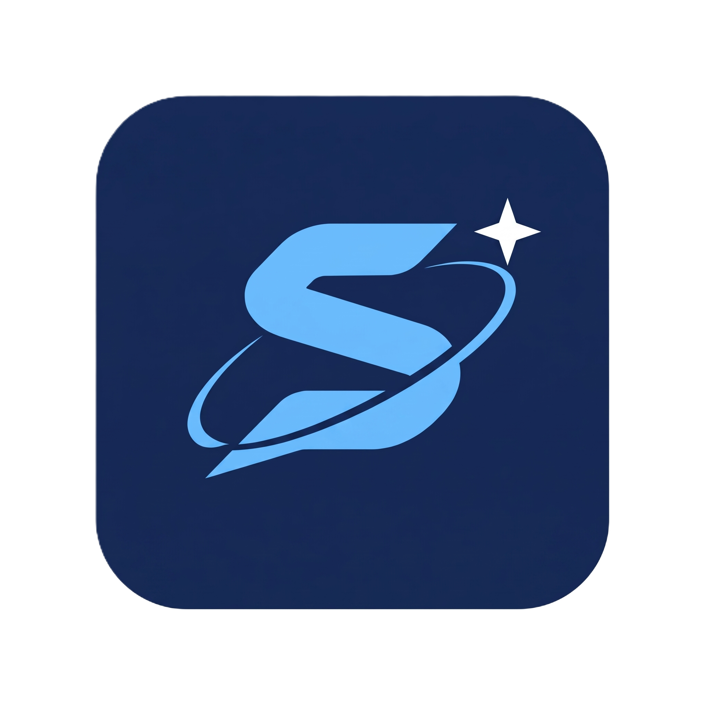

<div align="center">

  

  # Synoetis

  **The Second Brain & Engineering Operating System for Software Builders**

  *From Greek Synoesis (σύνεσις) — Total synthetic mastery, cognitive clarity, and focused execution.*

  [](https://github.com/athulrajmp21/Synoetis/releases)
  [](https://github.com/athulrajmp21/Synoetis/releases/latest)
  [](https://tauri.app)
  [](https://www.rust-lang.org)
  [](https://react.dev)
  [](https://www.sqlite.org)
  [](LICENSE)

  <br />

  [📥 **Download v1.0.0 Setup Installer (.exe)**](https://github.com/athulrajmp21/Synoetis/releases/latest) • [Features](#-core-capabilities) • [Architecture](#-architecture) • [Getting Started](#-development--build)

</div>

---

## ⚡ Overview

**Synoetis** is a high-performance desktop environment built with **Tauri v2, Rust, React, and SQLite**. Designed specifically for software engineers, computer science students, and technical builders, Synoetis unites knowledge management, technical interview preparation, academic planning, and deep work tracking into one privacy-first, 100% offline-capable application.

- **Zero Cloud Dependency**: Everything lives on your machine in an optimized WAL-mode SQLite database (`synoetis.db`).
- **Sub-Millisecond Speed**: Instantaneous queries, sub-10MB binary footprint, and near-zero memory footprint when idling in the system tray.
- **Warm Obsidian & Nude Design**: Thoughtfully tuned palette crafted for prolonged, distraction-free screen sessions.

---

## 🚀 Core Capabilities

### 1. 🗂️ Spaced Repetition (SRS Engine)
- **Algorithmic Recall**: SM-2 Leitner-based progressive flashcard review for both DSA algorithm patterns and engineering knowledge notes.
- **Review Scheduling**: Automatically schedules reviews with configurable quality grades (`Again`, `Hard`, `Good`, `Easy`) and ease factor multipliers.
- **Cross-Module Sync**: Direct flashcard review alerts surfaced right on the Command Center dashboard.

### 2. 💻 Technical DSA & Problem Tracker
- **Categorized Problem Vault**: Track solutions across 12 high-yield interview categories (Arrays & Two Pointers, Dynamic Programming, Graphs, Trees, Heaps, etc.).
- **Code & Complexity Logs**: Save time/space complexities, solution snippets, and revision notes.
- **Difficulty & Mastery Matrix**: Visual indicators for Easy, Medium, and Hard challenges.

### 3. 💼 Career OS (Job Pipeline & Interview Debriefs)
- **Fluid Kanban Board**: Real-time pointer-event drag-and-drop pipeline across 6 workflow stages (*Wishlist*, *Applied*, *OA Round*, *Interview*, *Offer*, *Rejected*).
- **Interview Question Debriefs**: Log specific coding problems, system architecture questions, interviewer feedback, and outcome reflections.
- **Salary & Compensation Tracker**: Monitor CTC ranges, referral contacts, and job posting URLs.

### 4. 🎓 Academic Command Center & GPA Simulator
- **Weekly Class Timetable**: 5-day Monday–Friday schedule grid with course codes, lecture halls, and instructor details.
- **Real-Time GPA Forecaster**: Simulate grade point impacts across active semesters and project cumulative graduation CGPA against target honors.
- **Syllabus & Assessment Tracker**: Track lab submissions, midterm exams, and semester milestones.

### 5. 🧠 Knowledge Hub & Local Markdown Sync
- **Notion-Style Block Notes**: Rich technical documentation with tags, importance tiers, and fast search.
- **Slash Commands (`/`)**: Instant block formatting with keyboard-first arrow navigation.
- **Bidirectional Markdown Sync**:
  - **Batch Export**: Native Windows folder picker exports your entire vault as standard `.md` files with YAML frontmatter compatible with Obsidian, Logseq, and Foam.
  - **Batch Import**: Ingest external markdown files into SQLite with automated metadata extraction.

### 6. ⏱️ Deep Work & Focus Engine
- **TopBar Countdown**: Live countdown indicator directly integrated into the frameless window header.
- **Pomodoro & Deep Work Modes**: Preset 25m focus, 50m deep work sprint, and 5m break sessions.
- **System Tray Docking**: Minimized background focus timer with native Windows toast notifications and gentle completion chimes.

### 7. 🛠️ Developer Snippet Vault
- **CLI & Script Cheat Sheets**: Fast lookup for Git, Docker, Kubernetes, Linux shell, and database commands.
- **Omnisearch Integration**: Access any snippet from anywhere using `Ctrl+K` with the dedicated `*` search filter token.

---

## 🏗️ Architecture

```
┌─────────────────────────────────────────────────────────────┐
│                    React 18 + Vite UI                       │
│  Zustand Stores • Lucide Icons • Tailwind CSS Design System │
└──────────────────────────────┬──────────────────────────────┘
                               │ IPC (Tauri v2 Invoke)
┌──────────────────────────────▼──────────────────────────────┐
│                    Tauri v2 (Rust 2021)                     │
│  Window Management • System Tray • Native Win32 Registry     │
└──────────────────────────────┬──────────────────────────────┘
                               │ rusqlite
┌──────────────────────────────▼──────────────────────────────┐
│             SQLite Database (WAL Mode Enabled)               │
│  20+ Versioned Relational Tables • Foreign Keys • Indexes   │
└─────────────────────────────────────────────────────────────┘
```

---

## 📥 Installation

Download the official release from the [GitHub Releases](https://github.com/athulrajmp21/Synoetis/releases) page:

- **Setup Installer (Recommended)**: `Synoetis_1.0.0_x64-setup.exe` — Self-contained NSIS installer with desktop shortcut and Start Menu integration (no admin rights required).
- **Enterprise Package**: `Synoetis_1.0.0_x64_en-US.msi` — Standard MSI installer for deployment.
- **Portable**: `Synoetis.exe` — Standalone zero-install executable.

---

## 🛠️ Development & Build

### Prerequisites
- [Node.js](https://nodejs.org/) (v18 or higher)
- [Rust](https://www.rust-lang.org/tools/install) (latest stable toolchain)
- Windows 10/11 x64

### Local Development
```bash
# Clone the repository
git clone https://github.com/athulrajmp21/Synoetis.git
cd Synoetis

# Install frontend dependencies
npm install

# Run desktop app in development mode
npm run tauri dev
```

### Production Release Build
```bash
# Build standalone executable and Windows NSIS installer
npx @tauri-apps/cli build
```
Built installers are output to:
`src-tauri/target/release/bundle/nsis/Synoetis_1.0.0_x64-setup.exe`

---

## 📄 License

Distributed under the MIT License. See [LICENSE](LICENSE) for details.
